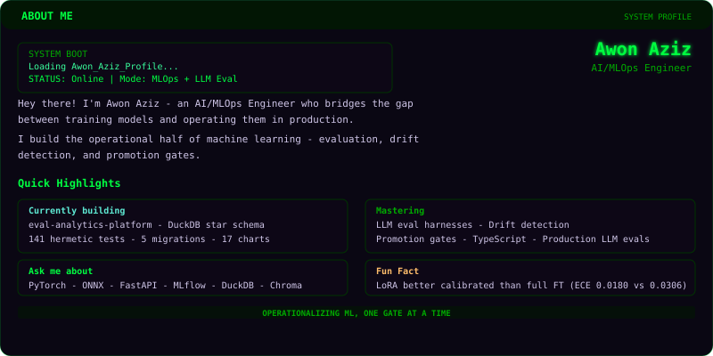

```text
root@awon:~# cat about.md
```

### 🎯 What I Build

| Module | Stack |
|--------|-------|
| `MLOps & LLM Eval` | `Python` `PyTorch` `ONNX` `FastAPI` |
| `Drift Detection` | `Evidently AI` `MLflow` `DuckDB` |
| `Promotion Gates` | `Chroma` `Kubernetes` `GitHub Actions` |
| `Serving & Infra` | `Docker` `SQL` `AWS` `Azure` `GCP` |

> `I build the operational half of machine learning.`



```text
root@awon:~# cat contacts.md
```

### 🌐 Connect With Me

| Platform | Handle |
|----------|--------|
| `Instagram` | [@awonaziz](https://instagram.com/awonaziz) |
| `LinkedIn` | [awonaziz](https://www.linkedin.com/in/awonaziz/) |
| `Email` | [awonaziz786@gmail.com](mailto:awonaziz786@gmail.com) |

```text
root@awon:~# cat stack.md
```

### 💻 Tech Stack

| Category | Technologies |
|----------|-------------|
| `ML / AI` | `Python` `PyTorch` `ONNX` `FastAPI` `MLflow` `DuckDB` `Chroma` `Evidently AI` |
| `Frontend` | `React` `JavaScript` `TypeScript` `HTML5` `CSS3` `Tailwind CSS` |
| `Backend` | `Node.js` `Express` `MongoDB` `MySQL` `Firebase` `Supabase` |
| `DevOps / Cloud` | `Docker` `Kubernetes` `AWS` `Azure` `GCP` `GitHub Actions` `GitLab CI` |
| `Tools` | `Git` `GitHub` `GitLab` `Postman` `Figma` `VS Code` |


```text
root@awon:~# cat stats.md
```

### 📊 GitHub Stats & Graphs


```text
root@awon:~# cat views.md
PROFILE_VIEWS=tracking&hellip;
```

```text
root@awon:~# echo "Always learning, always building."
```


