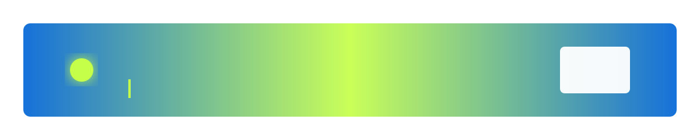

<picture>
  <source media="(prefers-color-scheme: dark)" srcset="https://raw.githubusercontent.com/AwonAziz/AwonAziz/main/assets/hero-dark.svg" />
  
</picture>

# Awon Aziz

**AI/MLOps Engineer — I build the operational half of machine learning: evaluation, drift detection, and promotion gates.**

→ **[awonaziz.github.io](https://awonaziz.github.io)** — the portfolio, with a written case study for each system below.

A model isn't finished when it trains well. It's finished when you can prove it still works, detect when it stops, and refuse to promote a replacement that only looks better. That's the part I work on.

Every repository ships with tests, a CI run, and numbers I measured myself — including the ones that came out worse than expected.

---

<picture>
  <source media="(prefers-color-scheme: dark)" srcset="https://raw.githubusercontent.com/AwonAziz/AwonAziz/main/assets/divider.svg" />
  
</picture>

## 🎯 About me

- 🔭 **Currently building:** `eval-analytics-platform` — six evaluation questions that are painful in a notebook and trivial in SQL, over a DuckDB star schema fed by every project's artefacts. 141 hermetic tests, 5 versioned migrations, 17 charts.
- 🌱 **Learning:** Advanced TypeScript type-level programming and production LLM eval harnesses.
- 💬 **Ask me about:** MLOps promotion gates, drift detection, LoRA calibration, and why most "LLM agents" shouldn't auto-execute.
- ⚡ **Outside code:** Urban sketching, mechanical keyboards, and running my own job-board aggregation pipeline (590 commits, 587 automated).

---

## 🛠 Tech stack

**Languages:** Python · TypeScript · SQL · Shell  
**ML / AI:** PyTorch · Hugging Face · ONNX · CrewAI · LangChain  
**MLOps / Deploy:** Docker · FastAPI · MLflow · Kubernetes · GitHub Actions  
**Cloud / Infra:** AWS · Azure · GCP · Red Hat Linux  
**Data:** DuckDB · Chroma · SQLite · Evidently AI

---

## 📦 Featured work

| Project | What it does | Outcome |
|---------|-------------|---------|
| **[eval-analytics-platform](https://github.com/AwonAziz/eval-analytics-platform)** | Six evaluation questions over a DuckDB star schema, with `data_origin` labelling so generated figures can never be read as measured. | 141 hermetic tests · 5 migrations · 17 charts · quality gate fails CI on analytical coverage |
| **[from-scratch-to-served](https://github.com/AwonAziz/from-scratch-to-served)** | LoRA fine-tuning on hand-written NumPy autodiff, exported to ONNX, quantised to INT8, served via FastAPI. | 0.9217 vs 0.9295 full FT on 1.1% of weights · LoRA better calibrated (ECE 0.0180 vs 0.0306) · INT8 67.8 MB vs 268.6 MB |
| **[llm-drift-monitor](https://github.com/AwonAziz/llm-drift-monitor)** | Embedding, output-quality, and LLM-as-judge drift tracking with 6 signals where effect size sets severity. | 184 tests · 4 CI jobs · 6 calibration bugs pinned by regression tests |
| **[Hybrid-retrieval](https://github.com/AwonAziz/Hybrid-retrieval)** | Sparse TF-IDF + dense retrieval fused with Reciprocal Rank Fusion over Chroma, feeding a two-agent root-cause copilot. | 8-case golden harness · corpus-size trust gate caught and fixed an LSA fallback regression |
| **[ml-lifecycle-platform](https://github.com/AwonAziz/ml-lifecycle-platform)** | MLflow-tracked training, FastAPI serving, champion/challenger promotion gated on measured F1 gain. | F1 0.873 / AUC 0.937 · under 5 ms p99 · mean PSI 1.66 across five features after injected drift |

---

## 🔧 Also here

- **[ai-incident-response-system](https://github.com/AwonAziz/ai-incident-response-system)** — multi-cloud Isolation Forest anomaly detection over AWS, Azure, GCP telemetry, extended by **[agentic-incident-copilot](https://github.com/AwonAziz/agentic-incident-copilot)** with Chroma knowledge base, hybrid retrieval, two CrewAI agents, human-review UI, and Kubernetes manifests.
- **[AI-Pair-Engineer](https://github.com/AwonAziz/AI-Pair-Engineer)** — four-stage review pipeline where each stage receives only upstream findings relevant to its job; every model response schema-validated with retry-and-correct; submitted code never executed or shell-interpolated.
- **[cleanjobfunnel](https://github.com/AwonAziz/cleanjobfunnel)** — unattended aggregation across 18 job boards (Greenhouse, Lever, Ashby, SmartRecruiters), refreshed ~20 min via scheduled workflow, published to live dashboard. No scraping, no middleman board.
- **Infrastructure labs** — 200+ hands-on commits across [DevOps & CI/CD](https://github.com/AwonAziz/Devops-CICD-labs), [Red Hat Linux](https://github.com/AwonAziz/RedHat-Linux-Labs), and [Cybersecurity](https://github.com/AwonAziz/Cybersecurity-labs).

---

## 💬 How I work

I'd rather ship a small system I can measure than a large one I can't. Every project reports what broke and why — the LSA regression, the six calibration bugs, the three bugs inside `from-scratch-to-served` — because a repository that only shows its successes teaches the wrong lesson.

---

<picture>
  <source media="(prefers-color-scheme: dark)" srcset="https://raw.githubusercontent.com/AwonAziz/AwonAziz/main/assets/divider.svg" />
  
</picture>

## 📊 Activity

---

## 🎓 Background

Diploma in Artificial Intelligence Operations — EduQual (UK), RQF Level 6 (bachelor's-level equivalent), Al Nafi International Colleges, 2026 — 90%.

---

## 📫 Let's connect

Islamabad, Pakistan — open to remote (EU or US overlap) and relocation to UAE, Saudi Arabia, Qatar, UK or EU.

[awonaziz786@gmail.com](mailto:awonaziz786@gmail.com) · [linkedin.com/in/awonaziz](https://www.linkedin.com/in/awonaziz) · +92 335 5528211

Open to MLOps and AI engineering roles. [Book a chat](https://calendly.com/awonaziz) or email me directly.
